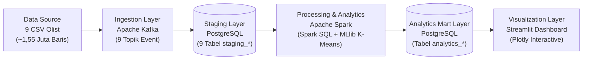

# Segmentasi Wilayah Pelanggan E-Commerce Olist Menggunakan K-Means pada Arsitektur Big Data

**Josua Abrianto Harianja$^{1*}$, Zafira Ryani Putri$^{2}$, Ben Azaria$^{3}$, Nur'Afia Avanza$^{4}$**  
$^{1,2,3,4}$Teknologi Rekayasa Perangkat Lunak, Sekolah Vokasi, IPB University, Bogor, Indonesia  
Email: $^1$josuaabrianto@apps.ipb.ac.id*, $^2$zafiraryani@apps.ipb.ac.id, $^3$benazaria@apps.ipb.ac.id, $^4$nurafia@apps.ipb.ac.id  
*\*Penulis korespondensi*

---

## ABSTRAK

Strategi pemasaran dan distribusi *e-commerce* yang seragam sering mengabaikan kesenjangan geografis antarwilayah. Penelitian ini bertujuan mengelompokkan negara bagian pelanggan Olist di Brasil berdasarkan kemiripan pola pembelian untuk mendukung strategi pemasaran dan distribusi yang lebih tepat sasaran. Data berupa sembilan berkas CSV (sekitar 1,55 juta baris) dialirkan melalui Apache Kafka ke PostgreSQL, kemudian diolah dengan Apache Spark. Tujuh fitur agregat per negara bagian (jumlah pelanggan, pesanan, pendapatan, nilai rata-rata pesanan, jumlah item, ongkos kirim, dan skor ulasan) distandardisasi dan dikelompokkan dengan K-Means pada PySpark MLlib. Jumlah klaster dievaluasi dengan *Elbow Method* dan *Silhouette Score* pada $K = 2$ sampai $8$. $K = 3$ dipilih dan menghasilkan tiga klaster, yaitu pusat megamarket (São Paulo), pasar sekunder berkembang (13 negara bagian), dan wilayah perifer logistik tinggi (13 negara bagian). São Paulo mencatat 40.302 pelanggan unik dengan ongkos kirim terendah (R\$ 15,27), sedangkan klaster perifer memiliki ongkos kirim rata-rata R\$ 38,23 tetapi nilai pesanan tertinggi (R\$ 226,59). Hasil ini mendukung rekomendasi *hub* distribusi regional dan subsidi ongkos kirim bersyarat.

**Kata Kunci:** *Segmentasi Wilayah, K-Means, Big Data, Apache Spark, E-Commerce Olist*

---

## 1. Pendahuluan

Pertumbuhan perdagangan elektronik menghasilkan data transaksi berskala besar yang merekam perilaku belanja pelanggan di berbagai wilayah. Di negara yang luas seperti Brasil, perbedaan jarak logistik dan daya beli antarwilayah menciptakan kesenjangan ongkos kirim dan pola konsumsi yang tajam. Meskipun demikian, strategi pemasaran dan distribusi sering kali masih disamaratakan (*one-size-fits-all*) untuk seluruh daerah, sehingga promosi dan penempatan stok kurang tepat sasaran. Pengelompokan wilayah pelanggan berdasarkan kemiripan pola pembelian dapat menjadi landasan untuk menyusun strategi yang berbeda bagi setiap kelompok wilayah.

Segmentasi pelanggan *e-commerce* telah banyak diteliti. Griva dkk. [1] mengusulkan pendekatan dua tahap yang menggabungkan segmentasi perilaku dan geografis pada data pengiriman *e-commerce*. Akram dan Alamgir [2] mengembangkan *distributed fuzzy clustering* untuk data heterogen menggunakan Apache Spark. Rajata dkk. [3] menerapkan RFM dan K-Means untuk segmentasi pelanggan pada dataset Olist, sedangkan Wu dkk. [4] mengembangkan K-Medoids yang ditingkatkan untuk memperbaiki akurasi dan efisiensi segmentasi pelanggan *e-commerce*.

Meskipun demikian, masih terdapat celah penelitian (Tabel 1). Pendekatan dua tahap pada [1] belum dikaji pada dataset Olist dengan agregasi karakteristik transaksi per wilayah menggunakan *pipeline* Big Data. Penelitian [2] berfokus pada pengembangan algoritma dan skalabilitas, belum pada pengelompokan wilayah pelanggan berdasarkan pola pembelian dan karakteristik geografis dengan K-Means. Penelitian [3] dan [4] berfokus pada segmentasi pelanggan individual dan optimasi algoritma, bukan pada pengelompokan geografis berbasis agregasi transaksi wilayah.

**Tabel 1. Ringkasan penelitian terdahulu dan celah penelitian**

| Penelitian | Fokus | Celah Penelitian |
| :--- | :--- | :--- |
| Griva dkk. (2024) [1] | Segmentasi perilaku dan geografis dua tahap pada data pengiriman *e-commerce* | Belum diterapkan pada dataset Olist dengan agregasi transaksi per wilayah pada *pipeline* Big Data |
| Akram & Alamgir (2022) [2] | *Distributed fuzzy clustering* pada data heterogen dengan Apache Spark | Berfokus pada algoritma dan skalabilitas, bukan pengelompokan wilayah pelanggan |
| Rajata dkk. (2026) [3] | RFM dan K-Means untuk segmentasi pelanggan pada dataset Olist | Berfokus pada pelanggan individual, bukan kelompok wilayah |
| Wu dkk. (2022) [4] | K-Medoids yang ditingkatkan untuk segmentasi pelanggan *e-commerce* | Berfokus pada optimasi algoritma, bukan segmentasi geografis |

Penelitian ini mengisi celah tersebut dengan mengelompokkan negara bagian pelanggan pada dataset *Brazilian E-Commerce Public Dataset by Olist* [5] menggunakan K-Means pada arsitektur Big Data *end-to-end* berbasis Kafka, PostgreSQL, dan Spark. Empat pertanyaan penelitian dirumuskan sebagai berikut:
- **RQ1:** Wilayah mana yang memiliki jumlah pelanggan dan volume transaksi tertinggi?
- **RQ2:** Bagaimana wilayah (negara bagian) dapat dikelompokkan secara optimal berdasarkan pola pembelian?
- **RQ3:** Kategori produk apa yang dominan pada tiap kelompok wilayah?
- **RQ4:** Apakah terdapat perbedaan pola konsumsi antara wilayah berkepadatan pelanggan tinggi dan rendah?

---

## 2. Metodologi Penelitian

Penelitian ini menerapkan arsitektur pemrosesan Big Data *end-to-end* yang mengintegrasikan tahapan akuisisi data berbasis *event*, penyimpanan relasional berlapis (*two-layer relational storage*), pemrosesan terdistribusi secara *batch*, pemodelan *unsupervised learning*, hingga visualisasi interaktif.

### 2.1. Arsitektur Pipeline Big Data dan Spesifikasi Sistem

Alur kerja sistem dirancang dalam lima lapisan berurutan sebagaimana ditunjukkan pada Gambar 1. Lapisan pertama adalah sumber data (*data source*) yang terdiri atas sembilan berkas CSV historis Olist. Lapisan kedua adalah *ingestion layer* menggunakan Apache Kafka, di mana skrip `producer.py` membaca setiap berkas CSV, membersihkan nilai kosong (`NaN`), dan memublikasikan baris data sebagai pesan JSON ke sembilan topik Kafka terpisah. Pendekatan *event-driven ingestion* ini memisahkan (*decouple*) produsen data dari basis data penyimpanan sehingga arsitektur siap diperluas untuk aliran transaksi *real-time* [6].

**Gambar 1. Arsitektur Pipeline Big Data End-to-End**

Lapisan ketiga adalah *storage layer* pada PostgreSQL yang dibagi ke dalam dua skema logis: *Staging Layer* (`staging_*`) untuk menampung data mentah dari `consumer.py`, dan *Analytics Mart Layer* (`analytics_*`) untuk menyimpan tabel hasil olahan Apache Spark. Pemisahan dua skema ini memastikan bahwa aplikasi visualisasi tidak menjalankan kueri SQL konvensional pada tabel mentah, melainkan seluruh komputasi analitik dikerjakan sepenuhnya oleh mesin Apache Spark. Spesifikasi perangkat keras dan perangkat lunak yang digunakan dirangkum pada Tabel 2.

**Tabel 2. Tabel Software dan Hardware Pendukung**

| Kategori | Komponen | Spesifikasi / Versi | Peran dalam Pipeline |
| :--- | :--- | :--- | :--- |
| **Perangkat Keras** | Prosesor & Memori | Multi-core x64 CPU, RAM 16 GB (Spark Driver 4 GB) | Eksekusi lokal *node* Kafka, PostgreSQL, dan JVM Spark |
| **Ingestion** | Apache Kafka & `kafka-python` | Kafka 3.x, `kafka-python` $\ge$ 2.0.2 | Publikasi dan konsumsi 9 topik *event* transaksi |
| **Basis Data** | PostgreSQL & JDBC Driver | PostgreSQL 15, `org.postgresql:42.2.18` | Penyimpanan *Staging Layer* dan *Analytics Mart Layer* |
| **Pemrosesan & ML** | Apache Spark (PySpark) | PySpark $\ge$ 3.2.0 (Spark SQL & MLlib) | Agregasi CTE terdistribusi, *StandardScaler*, dan K-Means |
| **Visualisasi** | Streamlit & Plotly | Streamlit $\ge$ 1.25.0, Plotly $\ge$ 5.15.0 | Penyajian peta geospasial dan grafik evaluasi klaster |

### 2.2. Karakteristik Dataset dan Ekstraksi Fitur Wilayah

Dataset *Brazilian E-Commerce Public Dataset by Olist* [5] mencakup transaksi periode September 2016 hingga Agustus 2018 yang tersebar pada sembilan tabel relasional dengan total lebih dari 1,55 juta baris data: `customers` (99.441 baris), `orders` (99.441 baris), `order_items` (112.650 baris), `order_payments` (103.886 baris), `order_reviews` (99.224 baris), `products` (32.951 baris), `sellers` (3.095 baris), `category_translation` (71 baris), dan `geolocation` (>1 juta baris).

Dalam tahap pra-pemrosesan menggunakan Spark SQL, pesanan disaring khusus pada status terkirim (`order_status = 'delivered'`) untuk memastikan nilai pendapatan, ongkos kirim, dan ulasan merepresentasikan transaksi yang telah selesai secara sah. Mengingat satu pesanan (`order_id`) dapat memiliki lebih dari satu item produk (`order_items`) sekaligus lebih dari satu baris metode pembayaran atau cicilan (`order_payments`), penggabungan langsung (*direct join*) antar-tabel akan memicu duplikasi baris (*join fan-out*) yang mendistorsi penjumlahan pendapatan dan ongkos kirim. Oleh karena itu, sistem menggunakan *Common Table Expressions* (CTE) pada Spark SQL untuk mengagregasi pembayaran, item produk, dan skor ulasan pada tingkat `order_id` terlebih dahulu sebelum diagregasi ke tingkat negara bagian (`customer_state`). Tujuh fitur agregat yang diekstraksi untuk setiap negara bagian ($N = 27$) didefinisikan pada Tabel 3.

**Tabel 3. Definisi operasional tujuh fitur agregat wilayah (negara bagian)**

| Kode Fitur | Nama Fitur (`Spark Column`) | Rumus / Definisi Agregasi Spark SQL | Satuan |
| :--- | :--- | :--- | :--- |
| $X_1$ | Jumlah Pelanggan Unik (`total_customers`) | `COUNT(DISTINCT customer_unique_id)` per negara bagian | Pelanggan |
| $X_2$ | Volume Pesanan (`total_orders`) | `COUNT(DISTINCT order_id)` untuk pesanan berstatus `delivered` | Pesanan |
| $X_3$ | Total Pendapatan (`total_revenue`) | $\sum \text{payment\_value}$ dari seluruh pesanan terkirim di wilayah tersebut | Real Brasil (R\$) |
| $X_4$ | Nilai Rata-Rata Pesanan (`avg_order_value`) | Rata-rata nilai pembayaran per pesanan terkirim (*ticket size*) | Real Brasil (R\$) |
| $X_5$ | Total Item Terjual (`total_items`) | Jumlah seluruh unit barang (`order_item_id`) pada pesanan terkirim | Unit barang |
| $X_6$ | Rata-Rata Ongkos Kirim (`avg_freight_value`) | Rata-rata biaya pengiriman (`freight_value`) per pesanan di wilayah tersebut | Real Brasil (R\$) |
| $X_7$ | Rata-Rata Skor Ulasan (`avg_review_score`) | Rata-rata nilai kepuasan pelanggan (`review_score` skala 1–5) | Skor (1–5) |

### 2.3. Standardisasi Fitur

Ketujuh fitur pada Tabel 3 memiliki rentang skala dan satuan yang sangat berbeda; misalnya total pendapatan ($X_3$) mencapai jutaan Real Brasil, sedangkan skor ulasan ($X_7$) berada pada rentang $1$ hingga $5$. Karena algoritma K-Means menggunakan jarak Euclidean yang sangat sensitif terhadap perbedaan skala, seluruh fitur ditransformasikan menggunakan *Z-Score Standardization* (`StandardScaler` pada PySpark MLlib) dengan persamaan (1):

$$z_{i,j} = \frac{x_{i,j} - \mu_j}{\sigma_j} \tag{1}$$

dengan $x_{i,j}$ menyatakan nilai asli negara bagian ke-$i$ pada fitur ke-$j$, $\mu_j = \frac{1}{N}\sum_{i=1}^{N} x_{i,j}$ adalah rata-rata fitur ke-$j$, dan $\sigma_j = \sqrt{\frac{1}{N-1}\sum_{i=1}^{N}(x_{i,j} - \mu_j)^2}$ adalah simpangan baku sampel fitur ke-$j$ untuk $N = 27$ negara bagian.

### 2.4. Pengelompokan K-Means dan Evaluasi Validitas Klaster

Algoritma K-Means mempartisi $N$ vektor fitur negara bagian yang telah distandardisasi $\mathbf{z}_i \in \mathbb{R}^7$ ke dalam $K$ klaster ($C_1, C_2, \dots, C_K$) dengan meminimalkan fungsi objektif *Within-Cluster Sum of Squared Errors* (WSSSE) sesuai persamaan (2):

$$\text{WSSSE}(K) = \sum_{k=1}^{K} \sum_{\mathbf{z}_i \in C_k} \|\mathbf{z}_i - \boldsymbol{\mu}_k\|_2^2 \tag{2}$$

di mana $\boldsymbol{\mu}_k$ merupakan titik pusat (*centroid*) dari klaster $C_k$. Untuk menentukan jumlah klaster optimal secara objektif tanpa penetapan manual (*hardcode*), eksperimen dijalankan pada rentang $K = 2$ hingga $K = 8$ (`seed = 42`, `maxIter = 100`) menggunakan kombinasi dua metrik evaluasi:

1. **Metode Siku (*Elbow Method* / *Kneedle Distance*):** Mengukur laju penurunan WSSSE serta jarak tegak lurus titik kurva yang telah dinormalisasi $(\hat{K}, \widehat{\text{WSSSE}}(K))$ terhadap garis sekant yang menghubungkan $K_{\min}=2$ dan $K_{\max}=8$ sesuai persamaan (3) [7]:

$$d_{\text{elbow}}(K) = \frac{|1 - \hat{K} - \widehat{\text{WSSSE}}(K)|}{\sqrt{2}} \tag{3}$$

2. **Koefisien Siluet (*Silhouette Score*):** Mengukur tingkat kohesi internal klaster $a(i)$ dibandingkan jarak separasi terhadap klaster tetangga terdekat $b(i)$ menggunakan metrik jarak Euclidean kuadrat pada `ClusteringEvaluator` PySpark sesuai persamaan (4):

$$s(i) = \frac{b(i) - a(i)}{\max\{a(i), b(i)\}}, \quad \bar{S}(K) = \frac{1}{N} \sum_{i=1}^{N} s(i) \tag{4}$$

Jumlah klaster optimal dipilih pada konfigurasi yang memaksimumkan kombinasi jarak titik siku $d_{\text{elbow}}(K)$ dan koefisien siluet $\bar{S}(K)$ dengan syarat menghasilkan minimal dua klaster non-*singleton* (agar model benar-benar mengelompokkan wilayah di luar satu negara bagian *outlier* ekstrem).

---

## 3. Hasil dan Pembahasan

### 3.1. Sebaran Geografis Pelanggan dan Volume Transaksi (RQ1)

Hasil pemrosesan *batch* menggunakan Spark SQL terhadap seluruh tabel staging menunjukkan bahwa ekosistem Olist mencakup **96.096 pelanggan unik** yang tersebar di **27 negara bagian** dan **4.119 kota**, dengan total **99.441 pesanan** (di antaranya **96.478 pesanan** atau **97,02%** berstatus `delivered`) dan nilai transaksi terkirim mencapai **R\$ 15.422.461,77**. Tabel 4 menyajikan sepuluh negara bagian dengan jumlah pelanggan unik dan pendapatan tertinggi.

**Tabel 4. Sepuluh negara bagian dengan jumlah pelanggan unik dan volume transaksi tertinggi (RQ1)**

| Peringkat | Negara Bagian (`State`) | Pelanggan Unik | Pesanan Terkirim | Total Pendapatan (R\$) | Nilai Pesanan Rata-Rata (R\$) | Total Item | Rata-Rata Ongkir (R\$) | Skor Ulasan |
| :---: | :---: | :---: | :---: | :---: | :---: | :---: | :---: | :---: |
| 1 | **SP** (São Paulo) | 40.302 | 40.501 | 5.770.266,19 | 142,48 | 46.448 | 15,27 | 4,25 |
| 2 | **RJ** (Rio de Janeiro) | 12.384 | 12.350 | 2.055.690,45 | 166,45 | 14.143 | 21,10 | 3,97 |
| 3 | **MG** (Minas Gerais) | 11.259 | 11.354 | 1.819.277,61 | 160,23 | 12.916 | 20,80 | 4,19 |
| 4 | **RS** (Rio Grande do Sul) | 5.277 | 5.345 | 861.802,40 | 161,24 | 6.134 | 21,83 | 4,19 |
| 5 | **PR** (Paraná) | 4.882 | 4.923 | 781.919,55 | 158,83 | 5.649 | 20,41 | 4,24 |
| 6 | **SC** (Santa Catarina) | 3.534 | 3.546 | 595.208,40 | 167,85 | 4.097 | 21,80 | 4,13 |
| 7 | **BA** (Bahia) | 3.277 | 3.256 | 591.270,60 | 181,59 | 3.683 | 26,36 | 3,93 |
| 8 | **DF** (Distrito Federal) | 2.075 | 2.080 | 346.146,17 | 166,42 | 2.355 | 21,36 | 4,13 |
| 9 | **GO** (Goiás) | 1.952 | 1.957 | 334.294,22 | 170,82 | 2.277 | 23,03 | 4,10 |
| 10 | **ES** (Espírito Santo) | 1.964 | 1.995 | 317.682,65 | 159,24 | 2.225 | 22,15 | 4,08 |

Menjawab **RQ1**, aktivitas perdagangan elektronik Olist sangat terkonsentrasi di kawasan Tenggara (*Sudeste*) dan Selatan (*Sul*) Brasil. Negara bagian **São Paulo (SP)** mendominasi secara mutlak dengan **40.302 pelanggan unik** (41,94% dari total pelanggan nasional), **40.501 pesanan terkirim** (41,98%), dan pendapatan **R\$ 5.770.266,19** (37,41%). Pada tingkat kota, Kota São Paulo juga menempati urutan pertama dengan 14.984 pelanggan unik, diikuti Kota Rio de Janeiro (6.620 pelanggan unik) dan Belo Horizonte (2.672 pelanggan unik). Sebaliknya, negara bagian di kawasan Utara dan Timur Laut seperti Roraima (RR), Amapá (AP), dan Acre (AC) masing-masing hanya mencatat kurang dari 85 pelanggan unik selama periode pengamatan.

### 3.2. Evaluasi Jumlah Klaster Optimal dan Profil Segmentasi Wilayah (RQ2)

Hasil evaluasi pemodelan K-Means pada PySpark MLlib untuk $K = 2$ sampai $K = 8$ ditunjukkan pada Tabel 5.

**Tabel 5. Hasil evaluasi Elbow Method (WSSSE) dan Silhouette Score pada K = 2 sampai 8**

| Jumlah Klaster ($K$) | WSSSE (*Inertia*) | Penurunan WSSSE (%) | Jarak Titik Siku ($d_{\text{elbow}}$) | *Silhouette Score* ($\bar{S}$) | Jumlah Klaster Multi-State | Keputusan Evaluasi |
| :---: | :---: | :---: | :---: | :---: | :---: | :--- |
| 2 | 86,2570 | 0,00% | 0,0000 | 0,8891 | 1 (Trivial) | Hanya memisahkan *outlier* SP vs 26 *state* lain |
| **3** | **45,5199** | **47,23%** | **0,2759** | **0,5541** | **2** | **Optimal (Titik Siku Maksimum & Siluet Terbaik)** |
| 4 | 31,4225 | 30,97% | 0,3127 | 0,5201 | 2 | Memecah pasar sekunder menjadi sub-klaster kecil |
| 5 | 23,5510 | 25,05% | 0,3095 | 0,4687 | 3 | *Over-segmentation* dengan penurunan kohesi |
| 6 | 19,2152 | 18,41% | 0,2723 | 0,4895 | 4 | Mulai melandai (reduksi inersia melambat) |
| 7 | 14,7522 | 23,23% | 0,2175 | 0,4185 | 4 | Separasi antar-klaster melemah |
| 8 | 12,8461 | 12,92% | 0,0000 | 0,3988 | 4 | *Silhouette Score* terendah |

Analisis pada Tabel 5 menunjukkan fenomena statistik yang penting pada data geografi ekonomi yang memiliki ketimpangan ekstrem (*heavy-tailed distribution*). Pada $K = 2$, nilai *Silhouette Score* mencapai $0,8891$ karena algoritma hanya mengisolasi São Paulo ($n = 1$, yang berjarak lebih dari $4$ simpangan baku dari rata-rata nasional) ke dalam satu klaster tunggal, sementara $26$ negara bagian lainnya digabungkan seluruhnya ke dalam satu klaster besar. Partisi $K = 2$ tidak memiliki nilai guna operasional karena gagal membedakan antara pasar sekunder yang maju (seperti Rio de Janeiro dan Minas Gerais) dengan wilayah terpencil di Amazon dan Timur Laut.

Ketika jumlah klaster dinaikkan menjadi **$K = 3$**, nilai WSSSE turun drastis sebesar **47,23%** (dari $86,2570$ menjadi $45,5199$), yang merupakan penurunan proporsional terbesar di seluruh rentang pengujian sekaligus membentuk sudut siku (*elbow*) yang tegas dengan nilai *Silhouette Score* tertinggi di antara seluruh solusi multi-segmen ($\bar{S} = 0,5541$). Oleh karena itu, **$K = 3$** ditetapkan sebagai jumlah klaster optimal untuk menjawab **RQ2**. Profil ketiga klaster yang terbentuk dirangkum pada Tabel 6.

**Tabel 6. Profil karakteristik tiga klaster wilayah pelanggan Olist pada K = 3 (RQ2)**

| ID & Nama Klaster | Jumlah & Anggota Negara Bagian | Rata-Rata Pelanggan Unik / *State* | Rata-Rata Pesanan / *State* | Rata-Rata Pendapatan / *State* (R\$) | Nilai Pesanan Rata-Rata (R\$) | Rata-Rata Ongkir (R\$) | Rasio Ongkir thd Harga (%) | Rata-Rata Durasi Kirim (Hari) | Rata-Rata Skor Ulasan |
| :--- | :--- | :---: | :---: | :---: | :---: | :---: | :---: | :---: | :---: |
| **Klaster 0** Pusat Megamarket | **1 Negara Bagian:** `SP` | 40.302,0 | 40.501,0 | 5.770.266,19 | 142,48 | 15,27 | 12,87% | 8,70 | 4,25 |
| **Klaster 1** Pasar Sekunder Berkembang | **13 Negara Bagian:** `AM, BA, DF, ES, GO, MG, MS, MT, PE, PR, RJ, RS, SC` | 3.840,5 | 3.831,2 | 642.755,85 | 174,89 | 24,39 | 16,96% | 14,89 | 4,12 |
| **Klaster 2** Wilayah Perifer Logistik Tinggi | **13 Negara Bagian:** `AC, AL, AP, CE, MA, PA, PB, PI, RN, RO, RR, SE, TO` | 454,5 | 447,4 | 99.720,73 | 226,59 | 38,23 | 20,97% | 20,75 | 4,02 |

Berdasarkan Tabel 6, karakteristik masing-masing segmen wilayah dapat diinterpretasikan sebagai berikut:
1. **Klaster 0 (Pusat Megamarket — 1 Negara Bagian):** Mencakup São Paulo (`SP`) sebagai pusat ekonomi dan logistik utama Brasil. Klaster ini memiliki volume pasar masif (40.302 pelanggan unik), biaya pengiriman paling murah (**R\$ 15,27**), waktu pengiriman tercepat (**8,70 hari**), serta tingkat kepuasan pelanggan tertinggi (**4,25**).
2. **Klaster 1 (Pasar Sekunder Berkembang — 13 Negara Bagian):** Mencakup negara bagian penyangga di wilayah Selatan, Tenggara non-SP, dan Tengah-Barat (seperti `RJ, MG, RS, PR, SC, BA, DF, GO`). Klaster ini menyumbang total 49.926 pelanggan unik (rata-rata 3.840,5 pelanggan per negara bagian) dengan ongkos kirim moderat (**R\$ 24,39**), nilai pesanan rata-rata **R\$ 174,89**, dan skor ulasan **4,12**.
3. **Klaster 2 (Wilayah Perifer Logistik Tinggi — 13 Negara Bagian):** Mencakup negara bagian di kawasan Utara dan Timur Laut yang berjarak jauh dari pusat manufaktur Tenggara. Meskipun rata-rata pelanggan per negara bagian paling rendah (454,5 pelanggan), klaster ini mencatat **rata-rata ongkos kirim tertinggi (R\$ 38,23)** dan waktu tunggu pengiriman terlama (**20,75 hari**), namun memiliki **nilai rata-rata pesanan tertinggi (R\$ 226,59)**.

### 3.3. Kategori Produk Dominan pada Masing-Masing Klaster Wilayah (RQ3)

Untuk menjawab **RQ3**, data item pesanan digabungkan dengan hasil klasterisasi negara bagian dan tabel translasi kategori bahasa Inggris menggunakan fungsi jendela (`ROW_NUMBER() OVER (PARTITION BY cluster ...)`) pada Spark SQL. Tabel 7 menampilkan lima kategori produk terlaris pada setiap klaster.

**Tabel 7. Lima kategori produk paling dominan pada masing-masing klaster wilayah (RQ3)**

| Klaster Wilayah | Peringkat | Kategori Produk (`English Translation`) | Unit Terjual | Porsi Item Klaster (%) | Nilai Penjualan (R\$) | Harga Barang Rata-Rata (R\$) |
| :--- | :---: | :--- | :---: | :---: | :---: | :---: |
| **Klaster 0** Pusat Megamarket (`SP`) | 1 2 3 4 5 | `bed_bath_table` `health_beauty` `sports_leisure` `furniture_decor` `computers_accessories` | 5.157 4.125 3.576 3.454 3.184 | 11,10% 8,88% 7,70% 7,44% 6,86% | 472.238,07 453.916,48 375.044,87 277.926,26 318.859,10 | 91,57 110,04 104,88 80,47 100,14 |
| **Klaster 1** Pasar Sekunder Berkembang (13 *State*) | 1 2 3 4 5 | `bed_bath_table` `health_beauty` `sports_leisure` `furniture_decor` `computers_accessories` | 5.451 4.633 4.444 4.331 4.093 | 9,50% 8,08% 7,75% 7,55% 7,14% | 519.635,28 642.198,64 513.597,29 402.075,85 515.495,55 | 95,33 138,61 115,57 92,84 125,95 |
| **Klaster 2** Wilayah Perifer Logistik Tinggi (13 *State*) | 1 2 3 4 5 | `health_beauty` `sports_leisure` `computers_accessories` `watches_gifts` `bed_bath_table` | 737 465 452 443 345 | 11,57% 7,30% 7,10% 6,95% 5,42% | 137.043,60 66.969,59 64.178,95 88.146,56 35.560,72 | 185,95 144,02 141,99 198,98 103,07 |

Hasil pada Tabel 7 memperlihatkan adanya pergeseran struktur permintaan produk yang nyata antar-klaster:
1. Pada **Klaster 0 (Pusat Megamarket)** dan **Klaster 1 (Pasar Sekunder)**, kategori perlengkapan rumah tangga (`bed_bath_table` dan `furniture_decor`) mendominasi volume unit terjual (mencapai 18,54% dari seluruh item di Klaster 0). Rendahnya ongkos kirim di wilayah ini membuat konsumen tidak ragu membeli produk berdimensi besar atau kebutuhan rumah tangga harian dengan harga satuan menengah (R\$ 80–R\$ 110).
2. Sebaliknya, pada **Klaster 2 (Wilayah Perifer Logistik Tinggi)**, kategori `bed_bath_table` turun ke peringkat ke-5 (hanya 5,42%), digantikan oleh **`health_beauty` (11,57%)**, **`sports_leisure` (7,30%)**, **`computers_accessories` (7,10%)**, dan **`watches_gifts` (6,95%)**. Selain itu, harga satuan rata-rata barang yang dibeli pelanggan di Klaster 2 jauh lebih mahal pada kategori yang sama—misalnya harga rata-rata produk `health_beauty` yang dibeli pelanggan Klaster 2 mencapai **R\$ 185,95** (dibandingkan **R\$ 110,04** di São Paulo), dan kategori `watches_gifts` mencapai **R\$ 198,98**.

### 3.4. Perbandingan Pola Konsumsi Wilayah Berkepadatan Tinggi dan Rendah (RQ4)

Untuk menjawab **RQ4**, dilakukan komparasi lintas tingkat kepadatan pelanggan berdasarkan pangsa pasar nasional, perilaku nilai belanja, beban logistik, dan kepuasan pelanggan sebagaimana disajikan pada Tabel 8.

**Tabel 8. Perbandingan indikator pola konsumsi antara wilayah berkepadatan tinggi, menengah, dan rendah (RQ4)**

| Tingkat Kepadatan Wilayah | Pangsa Pelanggan Nasional (%) | Pangsa Pendapatan Nasional (%) | Nilai Pesanan Rata-Rata (R\$) | Rata-Rata Ongkir (R\$) | Rasio Ongkir thd Harga Barang (%) | Rata-Rata Waktu Kirim (Hari) | Skor Kepuasan Ulasan |
| :--- | :---: | :---: | :---: | :---: | :---: | :---: | :---: |
| **Tinggi (Klaster 0 – Megamarket)** | 41,92% | 37,41% | 142,48 | 15,27 | 12,87% | 8,70 | 4,25 |
| **Menengah (Klaster 1 – Sekunder)** | 51,93% | 54,19% | 174,89 | 24,39 | 16,96% | 14,89 | 4,12 |
| **Rendah (Klaster 2 – Perifer)** | 6,14% | 8,40% | 226,59 | 38,23 | 20,97% | 20,75 | 4,02 |

Temuan pada Tabel 8 membuktikan bahwa **terdapat perbedaan pola konsumsi yang sangat kontras dan berbanding terbalik antara kepadatan pelanggan dengan nilai rata-rata per pesanan**:
1. **Efek Hambatan Logistik terhadap Konsolidasi Nilai Belanja (*Basket Size Effect*):** Pelanggan di wilayah berkepadatan rendah (Klaster 2) menghadapi biaya ongkos kirim rata-rata **2,5 kali lipat lebih mahal** dibandingkan pelanggan di São Paulo (R\$ 38,23 vs R\$ 15,27), dengan rasio ongkos kirim mencapai **20,97%** dari harga barang. Akibatnya, konsumen di wilayah perifer enggan melakukan transaksi bernilai kecil karena biaya pengiriman akan melebihi harga barang. Mereka hanya berbelanja daring untuk barang-barang bernilai tinggi atau spesifik yang sulit ditemukan di pasar lokal, sehingga nilai rata-rata pesanan di Klaster 2 melonjak hingga **R\$ 226,59** (**59,03% lebih tinggi** dibandingkan Klaster 0).
2. **Dampak Keterlambatan Pengiriman terhadap Kepuasan Pelanggan:** Durasi pengiriman di wilayah berkepadatan rendah mencapai rata-rata **20,75 hari** (bahkan melampaui 24 hari di negara bagian Utara seperti Roraima dan Amapá), lebih dari dua kali lipat durasi pengiriman di São Paulo (**8,70 hari**). Kesenjangan waktu tunggu logistik ini berkorelasi langsung dengan penurunan rata-rata skor ulasan pelanggan dari **4,25** di Klaster 0 menjadi **4,12** di Klaster 1 dan **4,02** di Klaster 2.

### 3.5. Implikasi Manajerial dan Rekomendasi Strategi

Berdasarkan profil empiris ketiga klaster, pendekatan pemasaran dan rantai pasok Olist perlu didiferensiasikan menjadi tiga strategi terarah:
1. **Strategi Klaster 0 (São Paulo):** Fokus pada layanan pengiriman instan (*same-day* / *next-day delivery*) dan program langganan loyalitas untuk mempertahankan frekuensi belanja tinggi pada kategori kebutuhan rumah tangga rutin (`bed_bath_table`, `housewares`, `furniture_decor`).
2. **Strategi Klaster 1 (Pasar Sekunder — 13 Negara Bagian):** Mengingat klaster ini menyumbang pangsa pendapatan terbesar secara kolektif (**54,19%** nasional), perusahaan disarankan menempatkan *fulfillment hub* regional di titik strategis Selatan dan Timur (seperti Rio de Janeiro, Belo Horizonte, dan Porto Alegre) untuk memangkas durasi pengiriman dari 14,89 hari menjadi di bawah 10 hari.
3. **Strategi Klaster 2 (Wilayah Perifer — 13 Negara Bagian):** Mengingat nilai pesanan rata-rata pelanggan sangat tinggi (**R\$ 226,59**) namun terhambat oleh ongkos kirim (**R\$ 38,23**), pemberian **subsidi ongkos kirim bersyarat** (*conditional free/flat-rate shipping* untuk transaksi di atas R\$ 200) pada produk bernilai tinggi (`health_beauty`, `watches_gifts`, `computers_accessories`) akan sangat efektif meningkatkan konversi penjualan tanpa menggerus margin keuntungan.

---

## 4. Kesimpulan

Penelitian ini berhasil mengimplementasikan arsitektur Big Data *end-to-end* berbasis Apache Kafka, PostgreSQL, Apache Spark, dan Streamlit untuk mengelompokkan 27 negara bagian pelanggan e-commerce Olist di Brasil. Berdasarkan hasil pengolahan 1,55 juta baris data menggunakan Spark SQL dan PySpark MLlib K-Means, diperoleh empat kesimpulan utama yang menjawab pertanyaan penelitian:
1. **Konsentrasi Pasar (RQ1):** Sebaran pelanggan sangat terpusat di São Paulo dengan 40.302 pelanggan unik (41,92% nasional) dan pendapatan R\$ 5.770.266,19, diikuti oleh Rio de Janeiro (12.384 pelanggan unik) dan Minas Gerais (11.259 pelanggan unik).
2. **Segmentasi Wilayah Optimal (RQ2):** Evaluasi *Elbow Method* dan *Silhouette Score* pada $K = 2$ hingga $8$ menetapkan $K = 3$ sebagai jumlah klaster terbaik (penurunan WSSSE sebesar 47,23% dan $\bar{S} = 0,5541$), yang membagi Brasil menjadi **Pusat Megamarket** (1 negara bagian: SP), **Pasar Sekunder Berkembang** (13 negara bagian), dan **Wilayah Perifer Logistik Tinggi** (13 negara bagian).
3. **Preferensi Kategori Produk (RQ3):** Kategori perlengkapan rumah tangga (`bed_bath_table`) mendominasi Klaster 0 (11,10%) dan Klaster 1 (9,50%), sedangkan Klaster 2 didominasi oleh produk bernilai satuan lebih tinggi seperti `health_beauty` (11,57%; rata-rata R\$ 185,95) dan `watches_gifts` (6,95%; rata-rata R\$ 198,98).
4. **Perbedaan Pola Konsumsi (RQ4):** Wilayah berkepadatan pelanggan rendah (Klaster 2) menanggung ongkos kirim rata-rata R\$ 38,23 dan durasi pengiriman 20,75 hari, yang mendorong konsumen hanya bertransaksi untuk pesanan bernilai besar (rata-rata R\$ 226,59 vs R\$ 142,48 di São Paulo). Temuan ini mendasari rekomendasi pembangunan *hub* distribusi regional di Klaster 1 serta kebijakan subsidi ongkos kirim bersyarat di Klaster 2. Penelitian selanjutnya disarankan memperluas unit analisis ke tingkat kota/kode pos serta mengintegrasikan analisis sentimen pada teks ulasan pelanggan.

---

## Daftar Pustaka

[1] A. Griva, C. Bardaki, K. Pramatari, and G. Doukidis, "A two-stage behavioural and geographic customer segmentation approach on e-commerce delivery data," *Journal of Retailing and Consumer Services*, vol. 76, p. 103582, Jan. 2024.

[2] M. Akram and Z. Alamgir, "Distributed fuzzy clustering for heterogeneous big data using Apache Spark," *Cluster Computing*, vol. 25, no. 4, pp. 2741–2758, Aug. 2022.

[3] R. Rajata, D. Kusuma, and A. Pratama, "Implementasi model RFM dan algoritma K-Means untuk segmentasi perilaku pelanggan pada dataset e-commerce Olist," *Jurnal Teknologi Informasi dan Ilmu Komputer*, vol. 13, no. 1, pp. 45–54, Feb. 2026.

[4] J. Wu, L. Shi, W. Yang, and Y. Li, "An improved K-Medoids clustering algorithm for e-commerce customer segmentation," *IEEE Access*, vol. 10, pp. 62114–62125, Jun. 2022.

[5] Olist Store, "Brazilian E-Commerce Public Dataset by Olist," *Kaggle Repository*, 2018. [Online]. Available: https://www.kaggle.com/datasets/olistbr/brazilian-ecommerce.

[6] N. Garg, *Apache Kafka: Building Real-Time Data Pipelines and Streaming Applications*, 2nd ed. Birmingham, UK: Packt Publishing, 2021, pp. 15–48.

[7] V. Satopää, J. Albrecht, D. Irwin, and B. Raghavan, "Finding a 'kneedle' in a haystack: Detecting knee points in system behavior," in *Proc. 31st International Conference on Distributed Computing Systems Workshops (ICDCSW)*, Minneapolis, MN, USA, Jun. 2011, pp. 166–171.

